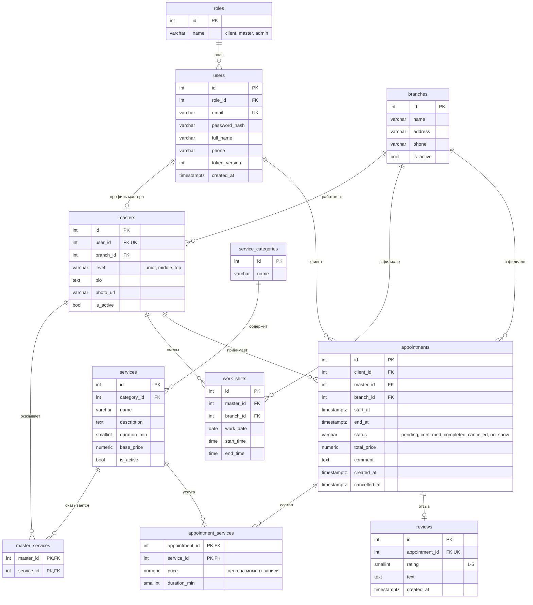
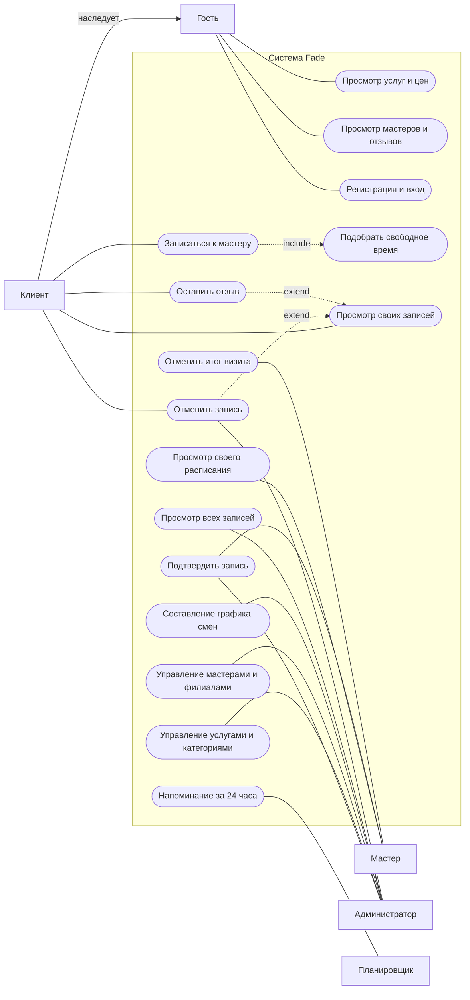
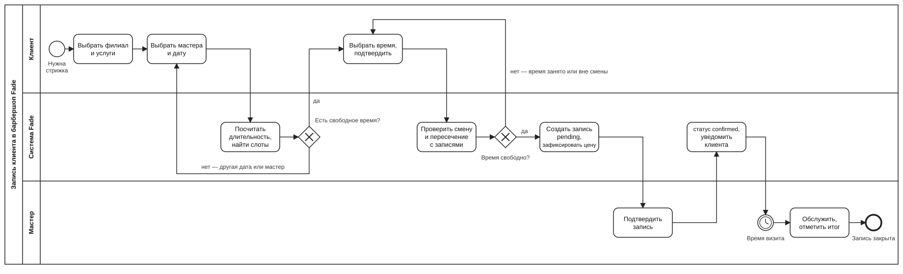
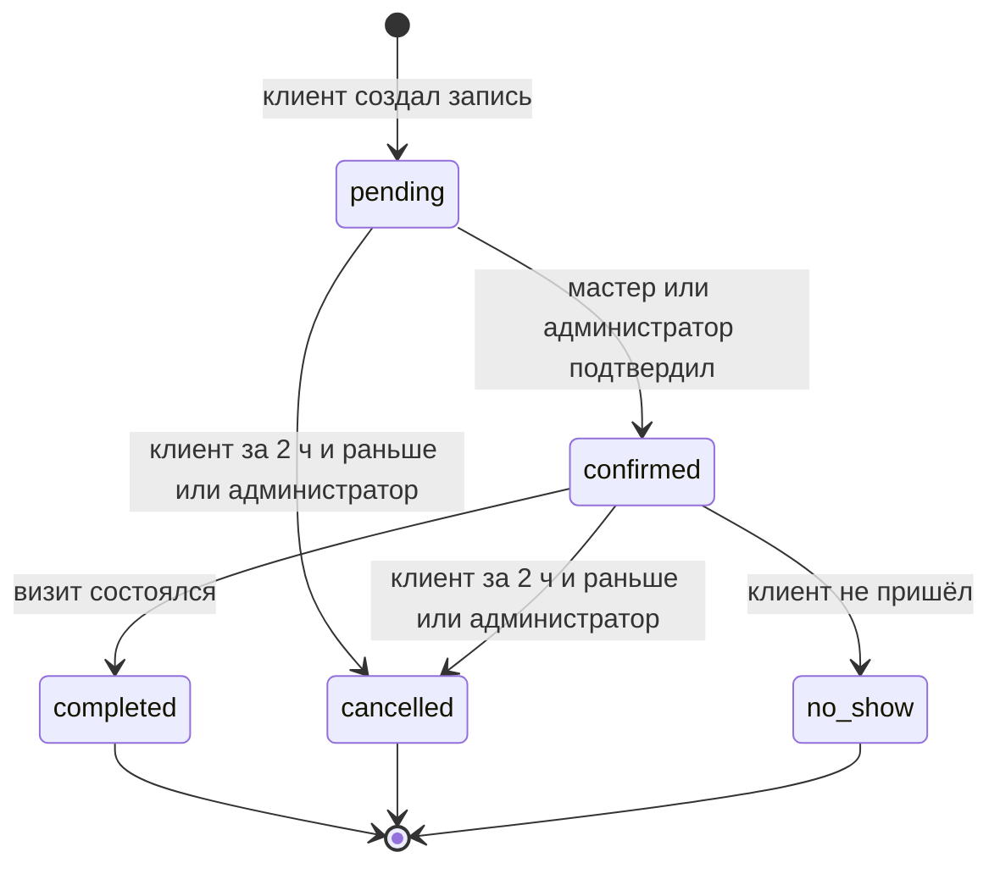
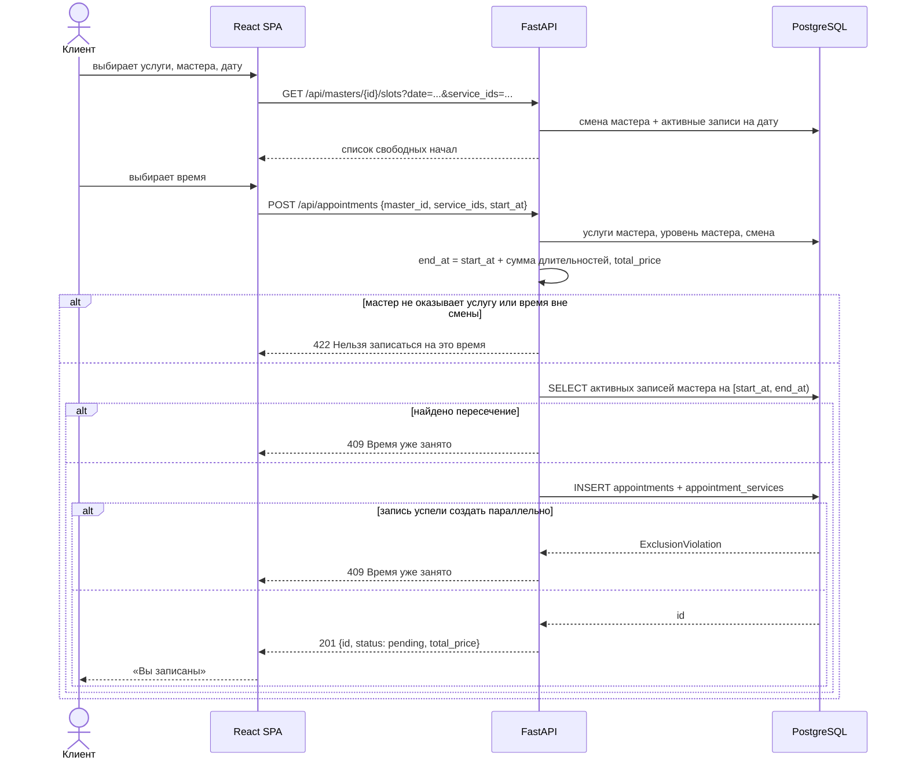

# Fade

Веб-сервис онлайн-записи в сеть барбершопов.

Учебный командный проект.

Предпроектная аналитика: [Анализ.md](Анализ.md)


## Идея

В небольших барбершопах запись до сих пор идёт через звонки и мессенджеры: администратор ведёт таблицу вручную, окна у мастеров теряются, клиент не видит, когда мастер свободен, и вынужден переписываться.

Fade решает это так: клиент сам выбирает филиал, услуги, мастера и свободное время, а мастер и администратор видят одно общее расписание.

Отличие от обычного бронирования «на даты»:

- время считается в минутах, длительность записи складывается из выбранных услуг;
- записаться можно только в смену мастера, шаг сетки — 15 минут;
- цена услуги зависит от уровня мастера;
- три роли с разными правами: клиент, мастер, администратор.


## Кто чем пользуется

**Гость** — смотрит филиалы, услуги и цены, мастеров и отзывы о них.

**Клиент** — записывается к мастеру на свободное время, видит свои записи в кабинете, отменяет их и оставляет отзыв после визита.

**Мастер** — видит своё расписание на день и неделю, подтверждает записи и отмечает итог визита (выполнено / клиент не пришёл).

**Администратор** — ведёт справочники (филиалы, категории, услуги), мастеров и их графики смен, видит все записи и простую статистику.


## Функциональные возможности

### MVP

- Регистрация и вход по email/паролю, JWT (access + refresh), выход отзывает все выданные токены пользователя
- Каталог услуг по категориям с ценами и длительностью
- Список мастеров с фильтром по филиалу и услуге, карточка мастера с отзывами
- Подбор свободного времени: сервер возвращает возможные начала записи на выбранную дату с учётом смены мастера, длительности услуг и уже занятых окон
- Запись: мастер, одна или несколько услуг, время начала; конец и цена считаются и фиксируются на сервере
- Нельзя записаться на время, которое пересекается с другой активной записью того же мастера
- Личный кабинет клиента: предстоящие и прошедшие записи, отмена, повтор записи
- Отзыв с оценкой 1–5 только после выполненной записи, один на запись
- Кабинет мастера: расписание на день, смена статуса записи
- Админ-часть: CRUD филиалов, категорий, услуг, мастеров; график смен; все записи с фильтрами
- Чужая запись недоступна по прямому запросу id (сервер отвечает 404)

### После MVP

- Напоминание на email за 24 часа до визита
- Лист ожидания: уведомление, если нужное время освободилось
- Отчёт для администратора: выручка и загрузка мастеров за период
- Промокоды и скидка на первый визит


## Бизнес-правила

- `end_at = start_at + сумма длительностей услуг`. Клиент передаёт только `start_at`.
- `total_price = сумма base_price услуг × коэффициент уровня мастера` (junior 1.0, middle 1.2, top 1.5). Цена каждой услуги копируется в `appointment_services` в момент записи, поэтому изменение прайса не меняет старые записи.
- Запись должна целиком помещаться в смену мастера (`work_shifts`).
- Интервал записи полуоткрытый `[start_at, end_at)`: запись 12:00–13:15 и следующая с 13:15 не пересекаются. В базе это обеспечивает `EXCLUDE USING gist (master_id WITH =, tstzrange(start_at, end_at, '[)') WITH &&)` для записей со статусом `pending` или `confirmed`.
- Клиент может отменить запись не позже чем за 2 часа до начала, администратор — в любое время.
- Активные статусы, которые занимают время мастера: `pending`, `confirmed`.
- Подтверждает запись мастер или администратор. Итог визита (`completed` / `no_show`) ставится только у подтверждённой записи.
- Отзыв можно оставить только по своей записи в статусе `completed`, один на запись.
- Все филиалы сети работают в одном часовом поясе, он задаётся в настройках сервера. Смены хранятся в местном времени (`date` + `time`), записи — в `timestamptz`; при проверке смена переводится в `timestamptz` в этом поясе.


## Как это устроено

```
React SPA  <—HTTPS/JSON—>  Nginx  —>  FastAPI  <—SQLAlchemy—>  PostgreSQL
```


## Данные

Одиннадцать таблиц: `roles`, `users`, `branches`, `masters`, `service_categories`, `services`, `master_services`, `work_shifts`, `appointments`, `appointment_services`, `reviews`.

- Мастер — это пользователь с ролью `master` и дополнительным профилем в `masters` (связь 1:1).
- Какие услуги делает мастер, хранится в связующей таблице `master_services` (M:N).
- В одной записи может быть несколько услуг, поэтому состав записи вынесен в `appointment_services`.
- `branch_id` в записи хранится отдельно от мастера: если мастер перейдёт в другой филиал, история не изменится.
- Отдельной таблицы слотов нет, свободное время вычисляется из смены и существующих записей.
- `users.token_version` попадает в каждый JWT. При выходе версия увеличивается, и все выданные раньше токены перестают приниматься, поэтому отдельная таблица токенов не нужна.




## Диаграммы

### Варианты использования (Use case)



Та же диаграмма в нотации UML (PlantUML): [docs/use_case.puml](docs/use_case.puml).

### Бизнес-процесс записи (BPMN)

Процесс от выбора услуги до закрытия записи. Дорожки: клиент, система, мастер.



Если выбранное время успели занять между показом слотов и подтверждением, база отклоняет запись по ограничению пересечения, а клиент возвращается к выбору времени.

### Жизненный цикл записи (State)



### Создание записи (Sequence)




## Технологии

**Бэкенд** — Python, FastAPI, SQLAlchemy 2.0, Alembic, Pydantic v2, JWT (PyJWT) + pwdlib/bcrypt.

**Фронтенд** — React + TypeScript, Vite, React Router, TanStack Query, CSS Modules.

**База и инфраструктура** — PostgreSQL (расширение `btree_gist` для ограничения пересечений), Docker Compose, Nginx, GitHub Actions.

**Тесты** — pytest + httpx на бэкенде, Vitest + Testing Library на фронте, ruff/ESLint/Prettier.


## API

Базовый путь — `/api/`

**Авторизация**
`POST /auth/register`, `POST /auth/login`, `POST /auth/refresh`, `POST /auth/logout`

**Профиль**
`GET /users/me`, `PATCH /users/me`

**Справочники**
`GET/POST /branches`, `PUT/DELETE /branches/{id}`
`GET/POST /categories`, `PUT/DELETE /categories/{id}`
`GET /services` — принимает `category_id`, `branch_id`; `POST /services`, `PUT/DELETE /services/{id}`
(запись — только администратор, чтение открыто всем)

**Мастера**
`GET /masters` — принимает `branch_id`, `service_id`
`GET /masters/{id}`, `GET /masters/{id}/reviews`
`GET /masters/{id}/slots?date=&service_ids=` — свободные начала записи
`POST /masters`, `PUT/DELETE /masters/{id}` — администратор
`GET /masters/{id}/shifts?date_from=&date_to=` — администратор и сам мастер
`POST /masters/{id}/shifts`, `DELETE /shifts/{id}` — администратор

**Записи**
`GET /appointments` — свои у клиента, к себе у мастера, все у администратора; принимает `date_from`, `date_to`, `status`, у администратора ещё `master_id`, `branch_id`
`POST /appointments` — сервер считает конец, цену и проверяет пересечение
`GET /appointments/{id}`
`PATCH /appointments/{id}/status` — мастер и администратор
`POST /appointments/{id}/cancel`
`POST /appointments/{id}/review`

**Статистика**
`GET /stats?date_from=&date_to=` — администратор: число записей по статусам, выручка по выполненным записям, число записей у каждого мастера


## Команда

| Имя | Зона ответственности |
|---|---|
| Кривошеев Матвей | тимлид и аналитик — репозиторий и CI, ER-модель, use case и BPMN, контракт API |
| Ватаншоев Артур | бэкенд — модели, миграции, авторизация, расчёт слотов, ограничение пересечений, тесты API |
| Байрамов Артём | фронтенд — макет и все страницы, слой `src/api/`, адаптивная вёрстка |
| Авагумян Роман | тестировщик — тест-кейсы и граничные сценарии: запись впритык к концу смены, двойная запись, отмена позже 2 часов, отзыв на чужую запись |
